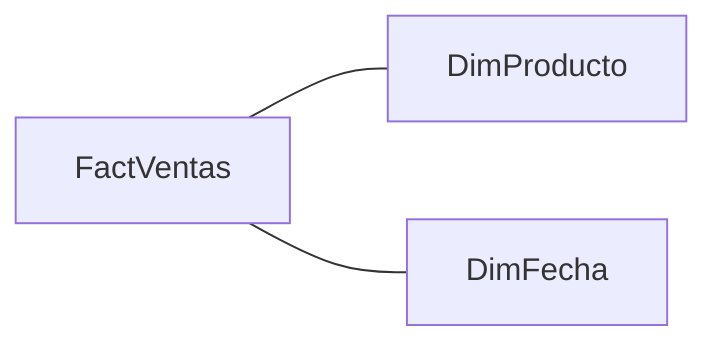

# Modelo: demo\_sales

<a id="obj-90708438697b5050"></a>

## Descripción general

**Definición propuesta — Generado con IA** · Análisis de ventas y rentabilidad

Modelo orientado al análisis de ventas, costos y rentabilidad bruta\. Relaciona los registros de ventas con un calendario y un catálogo de productos para estudiar la evolución temporal y la composición por producto y categoría\. Sus indicadores permiten analizar el importe vendido, el costo asociado, la utilidad y el margen bruto, los identificadores de venta distintos y el importe medio por identificador\.
**Validaciones:** [VAL-001](#val-001).


**Responsable del modelo:** no informado en los metadatos extraídos.

**Fecha de generación:** 2026-11-02 (UTC). **Versión del generador:** 2.0.0; esquema 0.4.

**Versión del modelo (SHA-256 de la definición TMDL):** <code>0e8650158ed63ee00aec2352961f165996b32d832c753062ed17e87323a4bb24</code>.
Identifica la definición, no la versión ni la actualización de los datos.

## Índice

- [Resumen y procedencia](#resumen)
- [Tablas](#tablas)
- [Origen, granularidad y alcance](#origen)
- [Diccionario de columnas](#columnas)
- [Jerarquías](#jerarquias)
- [Catálogo de medidas](#medidas)
- [Relaciones y conexiones](#relaciones)
- [Seguridad y permisos](#seguridad)
- [Validaciones funcionales](#validaciones)
- [Auditoría y cobertura](#auditoria)
- [Apéndice: comprobación TOM](#tom-verification)

<a id="resumen"></a>

## Resumen

| Elemento | Cantidad |
|---|---:|
| Tablas | 3 |
| Columnas | 12 |
| Medidas | 6 |
| Relaciones | 2 |
| Jerarquías | 0 |
| Puntos de revisión (no errores confirmados) | 6 |

## Procedencia del contenido

Las propiedades, fórmulas y descripciones originales se extraen de TMDL. Las definiciones de IA explican su significado y uso como propuestas de interpretación, sujetas a revisión funcional.
El comportamiento técnico identificado como análisis estático se obtiene de las fórmulas reconocidas y de reglas documentadas. Los datos y resultados no se ejecutaron.

| Procedencia de IA | Registro |
|---|---|
| Proveedor | Codex |
| Identificador del modelo | <code>No disponible: la ejecución no lo registró</code> |
| Fecha de generación del contenido IA | <code>2026-11-02T15:14:52.778939+00:00</code> |
| Versión del prompt | <code>business-definitions-4</code> |
| Esquema de respuesta | <code>object-definition-1</code> |

Definiciones publicadas: 24 de 24 objetos con respuesta IA (24 solicitados).
Desglose de definiciones publicadas: 1 modelo + 3 tablas + 12 columnas + 6 medidas + 2 relaciones.
El propio modelo es un objeto adicional a sus tablas, columnas, medidas, relaciones, jerarquías y niveles.
**Generado con IA** identifica las definiciones asistidas. Las incertidumbres compartidas se agrupan en el registro de validaciones; cada objeto enlaza sus pendientes.
Los controles de formato y afirmaciones detectables no garantizan la validez de todas las interpretaciones de negocio.


<a id="tablas"></a>

## Tablas

| Tabla | Columnas | Medidas | Oculta | Privada | Archivo TMDL | Línea |
|---|---:|---:|---|---|---|---:|
| DimFecha | 3 | 0 | No | No | tables/DimFecha\.tmdl | 1 |
| DimProducto | 3 | 0 | No | No | tables/DimProducto\.tmdl | 1 |
| FactVentas | 6 | 6 | No | No | tables/FactVentas\.tmdl | 1 |

Las rutas TMDL son relativas a definition/; identifican el metadato, no el origen de los datos.
Se excluyen las tablas automáticas de fechas identificadas por anotaciones de Power BI y sus relaciones.

Tablas automáticas excluidas (2):

- DateTableTemplate\_6afed921\-3bc0\-4d75\-bacd\-6b604be64f64
- LocalDateTable\_6f679d0e\-689e\-4050\-b551\-1f1cb79cadf2

<a id="obj-39b394c74e902d41"></a>

### Tabla: DimFecha

**Definición propuesta — Generado con IA** · Calendario de análisis

Tabla de referencia temporal que aporta fecha, año y mes para organizar el análisis de ventas\. Su campo Fecha se conecta con la fecha registrada en FactVentas, permitiendo que las selecciones del calendario filtren las ventas y sus indicadores\. Año y Mes proporcionan agrupaciones para comparar períodos\.
**Validaciones:** [VAL-005](#val-005).


<a id="obj-28bb8512ddbe6ad0"></a>

### Tabla: DimProducto

**Definición propuesta — Generado con IA** · Catálogo de productos

Tabla descriptiva que reúne el identificador, el nombre y la categoría de los productos\. Relaciona esas etiquetas de negocio con los registros de FactVentas mediante IdProducto\. Permite segmentar y comparar ventas, costos y rentabilidad por producto o categoría sin repetir esos atributos en cada registro de ventas\.
**Validaciones:** [VAL-006](#val-006).


<a id="obj-49e3491691eb4742"></a>

### Tabla: FactVentas

**Definición propuesta — Generado con IA** · Registros de ventas

Tabla de hechos que reúne identificadores de venta y producto, fecha, cantidad y valores unitarios de precio y costo\. Es la base de los indicadores de ventas, costos, utilidad, margen y ticket promedio\. Se conecta con DimFecha y DimProducto para analizar esos resultados por período, producto y categoría\.
**Validaciones:** [VAL-001](#val-001).


<a id="origen"></a>

## Origen, granularidad y alcance

### DimFecha

**Hechos extraídos — particiones:**

| Partición | Modo explícito | Tipo de origen | Origen de datos identificado | Línea TMDL |
|---|---|---|---|---:|
| DimFecha | <code>import</code> | <code>m</code> | Tabla embebida mediante <code>#table</code> en expresión M; los datos se definen en el modelo; funciones detectadas: <code>#table</code> | 38 |

### DimProducto

**Hechos extraídos — particiones:**

| Partición | Modo explícito | Tipo de origen | Origen de datos identificado | Línea TMDL |
|---|---|---|---|---:|
| DimProducto | <code>import</code> | <code>m</code> | Tabla embebida mediante <code>#table</code> en expresión M; los datos se definen en el modelo; funciones detectadas: <code>#table</code> | 29 |

### FactVentas

**Hechos extraídos — particiones:**

| Partición | Modo explícito | Tipo de origen | Origen de datos identificado | Línea TMDL |
|---|---|---|---|---:|
| FactVentas | <code>import</code> | <code>m</code> | Tabla embebida mediante <code>#table</code> en expresión M; los datos se definen en el modelo; funciones detectadas: <code>#table</code> | 122 |

| Capacidad | Estado | Alcance |
|---|---|---|
| Tablas, columnas, medidas, jerarquías, relaciones | Analizado | Inventario de objetos soportados; tablas de fechas según selección |
| Particiones | Analizado parcialmente | Nombre, tipo, modo explícito, clasificación de origen y huella de expresión; sin modos efectivos |
| Expresiones M de particiones | Analizado parcialmente | Clasificación de #table directo y funciones; sin ejecución, linaje completo ni valores de filas. Expresiones compartidas: no analizadas |
| Comportamiento DAX | Analizado parcialmente | DIVIDE de medidas, DISTINCTCOUNT de columna, SUMX de producto de dos columnas y resta de dos medidas; fuera de esos patrones se indica limitación |
| Seguridad RLS/OLS | No analizado | No se afirma que no exista |
| Grupos de cálculo y formatos dinámicos | No analizado | No se afirma que no existan; pueden alterar medidas y totales |
| Datos, unicidad, integridad y granularidad funcional | No analizado | Requieren datos y validación de negocio |
| Refresco, credenciales, resultados DAX y visuales | No analizado | No se conectó al motor ni se ejecutaron consultas |

<a id="columnas"></a>

## Diccionario de columnas

Las tablas contienen las propiedades técnicas principales. Las fichas siguientes conservan las definiciones y enlazan los pendientes; el resto de propiedades extraídas permanece en el inventario JSON.

### Columnas de tabla: DimFecha

**Archivo TMDL:** tables/DimFecha\.tmdl.

| Columna | Tipo de dato | Formato explícito | Agregación | Línea |
|---|---|---|---|---:|
| Fecha | <code>dateTime</code> | <code>Long Date</code> | <code>none</code> | 4 |
| Año | <code>int64</code> | <code>0</code> | <code>sum</code> | 20 |
| Mes | <code>int64</code> | <code>0</code> | <code>sum</code> | 29 |

<a id="obj-e461466440d971e3"></a>

#### Columna: Fecha

**Definición propuesta — Generado con IA** · Fecha del calendario

Día de referencia del calendario que se vincula con FactVentas\[Fecha\]\. Actúa como eje temporal de las ventas y permite que la selección de fechas del calendario afecte los registros considerados por las medidas\.


<a id="obj-741b96961e8a8dd2"></a>

#### Columna: Año

**Definición propuesta — Generado con IA** · Año de análisis

Componente anual asociado a la fecha del calendario\. Se utiliza para agrupar y filtrar las ventas por año y comparar la evolución de los indicadores entre períodos anuales\.
**Validaciones:** [VAL-005](#val-005).


<a id="obj-f4215ebe548ce224"></a>

#### Columna: Mes

**Definición propuesta — Generado con IA** · Mes de análisis

Componente mensual asociado a la fecha del calendario, almacenado como entero\. Permite agrupar las ventas por mes; al analizar varios años, debe combinarse con Año para distinguir el mismo mes de períodos diferentes\.


### Columnas de tabla: DimProducto

**Archivo TMDL:** tables/DimProducto\.tmdl.

| Columna | Tipo de dato | Formato explícito | Agregación | Línea |
|---|---|---|---|---:|
| IdProducto | <code>int64</code> | <code>0</code> | <code>none</code> | 4 |
| Producto | <code>string</code> | <code>No especificado</code> | <code>none</code> | 13 |
| Categoria | <code>string</code> | <code>No especificado</code> | <code>none</code> | 21 |

<a id="obj-e106480bf5a69933"></a>

#### Columna: IdProducto

**Definición propuesta — Generado con IA** · Identificador de producto

Código de producto utilizado para conectar el catálogo DimProducto con los registros de FactVentas\. Permite asociar a cada registro sus etiquetas de producto y categoría y utilizar esos atributos en la segmentación de los indicadores\.


<a id="obj-c6a127ab5ab7ebca"></a>

#### Columna: Producto

**Definición propuesta — Generado con IA** · Nombre del producto

Nombre descriptivo del producto utilizado como etiqueta de negocio en tablas, gráficos y filtros\. Permite presentar y comparar los indicadores por producto sin utilizar solamente su código técnico\.


<a id="obj-53adcb4dd2019eb3"></a>

#### Columna: Categoria

**Definición propuesta — Generado con IA** · Categoría del producto

Clasificación que agrupa productos para analizar resultados a un nivel más amplio que el producto individual\. Se utiliza para segmentar y comparar ventas, costos y rentabilidad entre los grupos definidos en el catálogo\.
**Validaciones:** [VAL-008](#val-008).


### Columnas de tabla: FactVentas

**Archivo TMDL:** tables/FactVentas\.tmdl.

| Columna | Tipo de dato | Formato explícito | Agregación | Línea |
|---|---|---|---|---:|
| IdVenta | <code>int64</code> | <code>0</code> | <code>sum</code> | 66 |
| IdProducto | <code>int64</code> | <code>0</code> | <code>none</code> | 75 |
| Fecha | <code>dateTime</code> | <code>Long Date</code> | <code>none</code> | 84 |
| Cantidad | <code>int64</code> | <code>0</code> | <code>sum</code> | 95 |
| PrecioUnitario | <code>int64</code> | <code>0</code> | <code>sum</code> | 104 |
| CostoUnitario | <code>int64</code> | <code>0</code> | <code>sum</code> | 113 |

<a id="obj-fcdc6543f22126bf"></a>

#### Columna: IdVenta

**Definición propuesta — Generado con IA** · Identificador de venta

Identificador utilizado por Cantidad Operaciones para contar valores de venta distintos\. También determina el denominador de Ticket Promedio a través de esa medida, por lo que su significado afecta la interpretación del importe medio por operación\.
**Validaciones:** [VAL-001](#val-001).


<a id="obj-547bef96b9a9203d"></a>

#### Columna: IdProducto

**Definición propuesta — Generado con IA** · Producto del registro de venta

Código que asocia el registro de venta con el catálogo DimProducto\. Proporciona el vínculo para analizar las cantidades e importes de FactVentas mediante el nombre y la categoría del producto\.


<a id="obj-3cef24328bf8dcfb"></a>

#### Columna: Fecha

**Definición propuesta — Generado con IA** · Fecha asociada a la venta

Fecha registrada para el movimiento de venta\. Se relaciona con DimFecha\[Fecha\] para que los filtros de fecha, año y mes delimiten las ventas incluidas en los indicadores\.
**Validaciones:** [VAL-009](#val-009).


<a id="obj-3e14a7b84d6867a9"></a>

#### Columna: Cantidad

**Definición propuesta — Generado con IA** · Cantidad registrada

Cantidad asociada al registro de venta\. Se multiplica por PrecioUnitario para calcular Ventas Brutas y por CostoUnitario para calcular Costo Total; representa la base cuantitativa utilizada en ambos importes\.
**Validaciones:** [VAL-003](#val-003).


<a id="obj-0dd3cc7fadbf09b3"></a>

#### Columna: PrecioUnitario

**Definición propuesta — Generado con IA** · Precio aplicado por unidad

Valor de precio utilizado por unidad de cantidad en el registro de venta\. Ventas Brutas calcula el importe del registro multiplicándolo por Cantidad y suma esos resultados en el contexto del análisis\.
**Validaciones:** [VAL-002](#val-002), [VAL-004](#val-004).


<a id="obj-a7a863ce59a8cfaa"></a>

#### Columna: CostoUnitario

**Definición propuesta — Generado con IA** · Costo aplicado por unidad

Valor de costo utilizado por unidad de cantidad en el registro de venta\. Costo Total lo multiplica por Cantidad; ese resultado participa en Utilidad Bruta y en Margen % a través de las medidas de apoyo\.
**Validaciones:** [VAL-002](#val-002), [VAL-004](#val-004).


<a id="jerarquias"></a>

## Jerarquías

No hay jerarquías en el inventario.

<a id="medidas"></a>

## Catálogo de medidas

Las propiedades son hechos extraídos; las explicaciones de comportamiento siguientes son análisis estático sin IA.
Aplican a las fórmulas reconocidas, sin incorporar grupos de cálculo ni formatos dinámicos, que no se analizan.

### Tabla: FactVentas

<a id="obj-a7e0e996761036b7"></a>

#### Medida: Ventas Brutas

**Definición propuesta — Generado con IA** · Importe de ventas

Importe de ventas calculado a partir de la cantidad y el precio unitario de los registros seleccionados\. Permite comparar el volumen monetario representado por las ventas entre períodos, productos y categorías\. Es la base de Utilidad Bruta, Margen % y Ticket Promedio\.
**Validaciones:** [VAL-002](#val-002), [VAL-003](#val-003), [VAL-004](#val-004).


**Comportamiento técnico — análisis estático (sin IA):**

Suma el producto FactVentas\[Cantidad\] × FactVentas\[PrecioUnitario\] calculado por cada fila de FactVentas en el contexto de filtro actual\.

El total evalúa de nuevo SUMX sobre las filas visibles en su contexto\. BLANK, texto y valores lógicos del resultado iterado no se suman\.

**Dependencias directas del patrón reconocido:** <code>FactVentas[Cantidad], FactVentas[PrecioUnitario]</code>. No representa un grafo transitivo completo.

Referencia del comportamiento: [Microsoft — SUMX](https://learn.microsoft.com/en-us/dax/sumx-function-dax).


**Carpeta:** Ventas

**Formato explícito:** <code>\$#,0.00;(\$#,0.00);\$#,0.00</code>

**Origen:** tables/FactVentas\.tmdl, línea 4.

```dax
SUMX(
    FactVentas,
    FactVentas[Cantidad] *
    FactVentas[PrecioUnitario]
)
```

<a id="obj-7c0524cf64ddeeb1"></a>

#### Medida: Costo Total

**Definición propuesta — Generado con IA** · Costo de las cantidades vendidas

Importe de costo asociado a las cantidades registradas en las ventas seleccionadas\. Se obtiene aplicando el costo unitario de cada registro a su cantidad y sirve como componente de comparación frente a Ventas Brutas para calcular la utilidad bruta\.
**Validaciones:** [VAL-002](#val-002), [VAL-003](#val-003), [VAL-004](#val-004).


**Comportamiento técnico — análisis estático (sin IA):**

Suma el producto FactVentas\[Cantidad\] × FactVentas\[CostoUnitario\] calculado por cada fila de FactVentas en el contexto de filtro actual\.

El total evalúa de nuevo SUMX sobre las filas visibles en su contexto\. BLANK, texto y valores lógicos del resultado iterado no se suman\.

**Dependencias directas del patrón reconocido:** <code>FactVentas[Cantidad], FactVentas[CostoUnitario]</code>. No representa un grafo transitivo completo.

Referencia del comportamiento: [Microsoft — SUMX](https://learn.microsoft.com/en-us/dax/sumx-function-dax).


**Carpeta:** Costos

**Formato explícito:** <code>0</code>

**Origen:** tables/FactVentas\.tmdl, línea 17.

```dax
SUMX(
    FactVentas,
    FactVentas[Cantidad] *
    FactVentas[CostoUnitario]
)
```

<a id="obj-17b36a5a306db1d1"></a>

#### Medida: Utilidad Bruta

**Definición propuesta — Generado con IA** · Resultado bruto de las ventas

Diferencia entre el importe calculado por Ventas Brutas y el costo calculado por Costo Total\. Permite evaluar el resultado de las ventas según los precios y costos registrados y comparar su aporte entre períodos o grupos de productos\. Es el numerador de Margen %\.
**Validaciones:** [VAL-003](#val-003), [VAL-004](#val-004).


**Comportamiento técnico — análisis estático (sin IA):**

Calcula \[Ventas Brutas\] menos \[Costo Total\] en el contexto de filtro actual\.

El total vuelve a evaluar ambas medidas en el contexto del total antes de restarlas\.

**Dependencias directas del patrón reconocido:** <code>FactVentas[Ventas Brutas], FactVentas[Costo Total]</code>. No representa un grafo transitivo completo.

**Carpeta:** Rentabilidad

**Formato explícito:** <code>0</code>

**Origen:** tables/FactVentas\.tmdl, línea 28.

```dax
[Ventas Brutas] - [Costo Total]
```

<a id="obj-9bf5d8e57e3dda4c"></a>

#### Medida: Margen %

**Definición propuesta — Generado con IA** · Proporción de utilidad sobre ventas

Proporción que representa Utilidad Bruta respecto de Ventas Brutas\. Expresa cuánto resultado bruto calculado corresponde a cada unidad de importe vendido\. Con componentes monetarios comparables, una razón de 0,25 se interpreta como un margen del 25%; este ejemplo explica la escala y no es un resultado del modelo\.
**Validaciones:** [VAL-003](#val-003), [VAL-007](#val-007).


**Comportamiento técnico — análisis estático (sin IA):**

Calcula \[Utilidad Bruta\] / \[Ventas Brutas\] en el contexto de filtro actual\.

Se interpreta como unidades del numerador por cada unidad del denominador\.

Devuelve BLANK cuando \[Ventas Brutas\] es cero o BLANK\.

El total recalcula el cociente en su propio contexto; no suma los cocientes de las filas ni calcula su promedio simple\.

**Dependencias directas del patrón reconocido:** <code>FactVentas[Utilidad Bruta], FactVentas[Ventas Brutas]</code>. No representa un grafo transitivo completo.

Referencia del comportamiento: [Microsoft — DIVIDE](https://learn.microsoft.com/en-us/dax/divide-function-dax) · [Guía de ceros y BLANK](https://learn.microsoft.com/en-us/dax/best-practices/dax-divide-function-operator).


**Carpeta:** Rentabilidad

**Formato explícito:** <code>No especificado</code>

**Origen:** tables/FactVentas\.tmdl, línea 35.

```dax
DIVIDE(
    [Utilidad Bruta],
    [Ventas Brutas]
)
```

<a id="obj-47149fa9cc03e87b"></a>

#### Medida: Cantidad Operaciones

**Definición propuesta — Generado con IA** · Recuento de identificadores de venta

Cantidad de identificadores IdVenta distintos presentes en las ventas seleccionadas\. Se utiliza como base para interpretar el número de operaciones y como denominador de Ticket Promedio\. Los registros que comparten identificador contribuyen al mismo valor distinto, por lo que el indicador no equivale a contar filas\.
**Validaciones:** [VAL-001](#val-001).


**Comportamiento técnico — análisis estático (sin IA):**

Cuenta valores distintos de FactVentas\[IdVenta\] en el contexto de filtro actual\.

Incluye BLANK como un valor distinto; sin filas devuelve BLANK\.

El total vuelve a contar los valores distintos; no suma los recuentos de las filas\.

**Dependencias directas del patrón reconocido:** <code>FactVentas[IdVenta]</code>. No representa un grafo transitivo completo.

Referencia del comportamiento: [Microsoft — DISTINCTCOUNT](https://learn.microsoft.com/en-us/dax/distinctcount-function-dax).


**Carpeta:** Indicadores

**Formato explícito:** <code>0</code>

**Origen:** tables/FactVentas\.tmdl, línea 46.

```dax
DISTINCTCOUNT(
    FactVentas[IdVenta]
)
```

<a id="obj-3fefcf5ceb9e85a3"></a>

#### Medida: Ticket Promedio

**Definición propuesta — Generado con IA** · Importe medio por identificador de venta

Importe de Ventas Brutas por cada identificador de venta distinto contado por Cantidad Operaciones\. Permite comparar el valor medio de los grupos de venta seleccionados entre períodos, productos o categorías\.
**Validaciones:** [VAL-001](#val-001), [VAL-003](#val-003).


**Comportamiento técnico — análisis estático (sin IA):**

Calcula \[Ventas Brutas\] / \[Cantidad Operaciones\] en el contexto de filtro actual\.

Se interpreta como unidades del numerador por cada unidad del denominador\.

Devuelve BLANK cuando \[Cantidad Operaciones\] es cero o BLANK\.

El total recalcula el cociente en su propio contexto; no suma los cocientes de las filas ni calcula su promedio simple\.

**Dependencias directas del patrón reconocido:** <code>FactVentas[Ventas Brutas], FactVentas[Cantidad Operaciones]</code>. No representa un grafo transitivo completo.

Referencia del comportamiento: [Microsoft — DIVIDE](https://learn.microsoft.com/en-us/dax/divide-function-dax) · [Guía de ceros y BLANK](https://learn.microsoft.com/en-us/dax/best-practices/dax-divide-function-operator).


**Carpeta:** Indicadores

**Formato explícito:** <code>No especificado</code>

**Origen:** tables/FactVentas\.tmdl, línea 55.

```dax
DIVIDE(
    [Ventas Brutas],
    [Cantidad Operaciones]
)
```


<a id="relaciones"></a>

## Relaciones

La vista resumida identifica las columnas conectadas y el sentido del filtro. La cardinalidad, el estado y la procedencia se detallan por relación.

Esta vista permanece legible al copiar o exportar a un visor sin Mermaid:

| Conexión entre columnas | Filtro efectivo |
|---|---|
| FactVentas\[IdProducto\] ↔ DimProducto\[IdProducto\] | El filtro viaja de DimProducto \(toColumn\) hacia FactVentas \(fromColumn\)\. |
| FactVentas\[Fecha\] ↔ DimFecha\[Fecha\] | El filtro viaja de DimFecha \(toColumn\) hacia FactVentas \(fromColumn\)\. |

<details>
<summary>Diagrama para visores compatibles con Mermaid</summary>



</details>

Origen y destino corresponden a fromColumn y toColumn. Los predeterminados omitidos se resuelven con las reglas documentadas en el [apéndice de comprobación TOM](#tom-verification).

<a id="obj-f0682f33d13408ba"></a>

### Relación: FactVentas\[IdProducto\] ↔ DimProducto\[IdProducto\]

**Identificador:** <code>AutoDetected_993b499f-1962-4d3f-a0e9-03556b9de6c7</code>.

**Definición propuesta — Generado con IA** · Ventas por producto y categoría

Conecta el producto registrado en FactVentas con su descripción en DimProducto\. Permite que las selecciones de producto o categoría filtren las ventas, sus costos y los indicadores derivados\. La configuración efectiva aplica el filtro del catálogo hacia FactVentas\.


**Origen del metadato:** relationships\.tmdl, línea 6.

| Propiedad | Valor | Procedencia |
|---|---|---|
| Tabla de origen | FactVentas | Hecho extraído |
| Columna de origen | IdProducto | Hecho extraído |
| Tabla de destino | DimProducto | Hecho extraído |
| Columna de destino | IdProducto | Hecho extraído |
| Cardinalidad de origen | Muchos (<code>many</code>) | Predeterminado verificado — [TOM](#tom-verification) |
| Cardinalidad de destino | Uno (<code>one</code>) | Predeterminado verificado — [TOM](#tom-verification) |
| Dirección de filtro | Una dirección (<code>oneDirection</code>) | Predeterminado verificado — [TOM](#tom-verification) |
| Activa | Sí (<code>true</code>) | Predeterminado verificado — [TOM](#tom-verification) |

**Funcionamiento:** El filtro viaja de DimProducto \(toColumn\) hacia FactVentas \(fromColumn\)\.

<a id="obj-49b017a4a021df48"></a>

### Relación: FactVentas\[Fecha\] ↔ DimFecha\[Fecha\]

**Identificador:** <code>29e4aa9d-3435-a4d9-ddd4-d5e51b79fd3d</code>.

**Definición propuesta — Generado con IA** · Ventas por fecha de calendario

Conecta la fecha registrada en FactVentas con la fecha de DimFecha\. Permite que los filtros del calendario, incluidos Año y Mes, delimiten las ventas consideradas por las medidas\. La configuración efectiva aplica el filtro de DimFecha hacia FactVentas\.


**Origen del metadato:** relationships\.tmdl, línea 10.

| Propiedad | Valor | Procedencia |
|---|---|---|
| Tabla de origen | FactVentas | Hecho extraído |
| Columna de origen | Fecha | Hecho extraído |
| Tabla de destino | DimFecha | Hecho extraído |
| Columna de destino | Fecha | Hecho extraído |
| Cardinalidad de origen | Muchos (<code>many</code>) | Predeterminado verificado — [TOM](#tom-verification) |
| Cardinalidad de destino | Uno (<code>one</code>) | Predeterminado verificado — [TOM](#tom-verification) |
| Dirección de filtro | Una dirección (<code>oneDirection</code>) | Predeterminado verificado — [TOM](#tom-verification) |
| Activa | Sí (<code>true</code>) | Predeterminado verificado — [TOM](#tom-verification) |

**Funcionamiento:** El filtro viaja de DimFecha \(toColumn\) hacia FactVentas \(fromColumn\)\.


<a id="seguridad"></a>

## Seguridad y permisos

Los roles RLS, las restricciones OLS y los permisos de lectura/escritura no fueron extraídos por esta versión. No se determina quién puede ver o modificar los datos. Deben documentarse desde la configuración del modelo y del servicio; su ausencia en este documento no demuestra que no existan.

<a id="validaciones"></a>

## Validaciones funcionales

Cada pendiente se describe una sola vez. Las preguntas se sugieren a partir de la estructura y las notas disponibles; no confirman granularidad ni reglas de negocio.

<a id="val-001"></a>

### VAL-001 — Significado de IdVenta

Confirmar qué representa FactVentas\[IdVenta\], si puede repetirse y cuándo corresponde a una operación de negocio\. Para FactVentas, confirmar si una fila representa operación, línea o movimiento y qué campos identifican el registro\.

**Afecta a:** [FactVentas](#obj-49e3491691eb4742), [FactVentas\[IdVenta\]](#obj-fcdc6543f22126bf), [FactVentas\[Cantidad Operaciones\]](#obj-47149fa9cc03e87b), [FactVentas\[Ticket Promedio\]](#obj-3fefcf5ceb9e85a3), [demo\_sales](#obj-90708438697b5050).
**Origen:** dudas propuestas por IA; análisis estático; síntesis del generador.

<a id="val-002"></a>

### VAL-002 — Moneda de los importes

Confirmar la moneda de los importes y si existen conversiones antes de comparar o combinar precios, costos y resultados\.

**Afecta a:** [FactVentas\[PrecioUnitario\]](#obj-0dd3cc7fadbf09b3), [FactVentas\[CostoUnitario\]](#obj-a7a863ce59a8cfaa), [FactVentas\[Ventas Brutas\]](#obj-a7e0e996761036b7), [FactVentas\[Costo Total\]](#obj-7c0524cf64ddeeb1).
**Origen:** dudas propuestas por IA; análisis estático; síntesis del generador.

<a id="val-003"></a>

### VAL-003 — Unidades y convenciones de cantidades

Confirmar las unidades de las cantidades registradas, las convenciones para devoluciones o cantidades negativas y la compatibilidad de unidades de los indicadores\.

**Afecta a:** [FactVentas\[Cantidad\]](#obj-3e14a7b84d6867a9), [FactVentas\[Margen %\]](#obj-9bf5d8e57e3dda4c), [FactVentas\[Ventas Brutas\]](#obj-a7e0e996761036b7), [FactVentas\[Costo Total\]](#obj-7c0524cf64ddeeb1), [FactVentas\[Utilidad Bruta\]](#obj-17b36a5a306db1d1), [FactVentas\[Ticket Promedio\]](#obj-3fefcf5ceb9e85a3).
**Origen:** dudas propuestas por IA; análisis estático; síntesis del generador.

<a id="val-004"></a>

### VAL-004 — Alcance de precios y costos

Confirmar qué incluyen los precios y costos: impuestos, descuentos, conceptos de costo y método de valoración\. Precisar el alcance del resultado bruto frente a otros resultados contables\.

**Afecta a:** [FactVentas\[PrecioUnitario\]](#obj-0dd3cc7fadbf09b3), [FactVentas\[CostoUnitario\]](#obj-a7a863ce59a8cfaa), [FactVentas\[Ventas Brutas\]](#obj-a7e0e996761036b7), [FactVentas\[Costo Total\]](#obj-7c0524cf64ddeeb1), [FactVentas\[Utilidad Bruta\]](#obj-17b36a5a306db1d1).
**Origen:** dudas propuestas por IA; análisis estático; síntesis del generador.

<a id="val-005"></a>

### VAL-005 — Granularidad y cobertura de DimFecha

Confirmar si representa una fila por día, qué período cubre, si las fechas son continuas y si año/mes siguen calendario civil o fiscal\.

**Afecta a:** [DimFecha](#obj-39b394c74e902d41), [DimFecha\[Año\]](#obj-741b96961e8a8dd2).
**Origen:** dudas propuestas por IA; preguntas guiadas por la estructura; síntesis del generador.

<a id="val-006"></a>

### VAL-006 — Granularidad e historia de DimProducto

Confirmar si representa un producto actual o admite versiones históricas del mismo código; en ese caso, definir cómo se identifica cada versión\.

**Afecta a:** [DimProducto](#obj-28bb8512ddbe6ad0).
**Origen:** preguntas guiadas por la estructura; síntesis del generador.

<a id="val-007"></a>

### VAL-007 — Presentación de indicadores

Revisar formato porcentual cuando corresponda, escala y decimales\. El formato explícito de cada objeto está en su ficha técnica\.

**Afecta a:** [FactVentas\[Margen %\]](#obj-9bf5d8e57e3dda4c).
**Origen:** dudas propuestas por IA; análisis estático; síntesis del generador.

<a id="val-008"></a>

### VAL-008 — Definición funcional por confirmar

El criterio de clasificación y el mantenimiento de las categorías no están documentados en el modelo\.

**Afecta a:** [DimProducto\[Categoria\]](#obj-53adcb4dd2019eb3).
**Origen:** dudas propuestas por IA; síntesis del generador.

<a id="val-009"></a>

### VAL-009 — Definición funcional por confirmar

Confirmar si corresponde a emisión, entrega, contabilización u otro momento del proceso comercial\.

**Afecta a:** [FactVentas\[Fecha\]](#obj-3cef24328bf8dcfb).
**Origen:** dudas propuestas por IA; síntesis del generador.


<a id="auditoria"></a>

## Auditoría básica

Estos hallazgos son **puntos de revisión, no errores confirmados**. No se ejecuta DAX ni se modifica Power BI.
Se evalúa el inventario seleccionado; las tablas automáticas excluidas y sus objetos no generan hallazgos.
La ausencia de descripciones se informa como cobertura de documentación original y no genera un hallazgo por objeto.

| Documentación original | Con descripción | Total | Cobertura |
|---|---:|---:|---|
| Tablas | 0 | 3 | 0.0% |
| Columnas | 0 | 12 | 0.0% |
| Medidas | 0 | 6 | 0.0% |

| Regla | Objetos examinados | Condición de revisión |
|---|---:|---|
| COL001 | 12 | sum \+ nombre de identificador/calendario \(heurística\) |
| COL002 | 12 | sum \+ nombre de valor unitario \(heurística\) |
| FMT001 | 6 | % en nombre y ausencia de formato estático |
| REL001 | 2 | isActive: false explícito |
| REL002 | 2 | bothDirections explícito |

**Validaciones no realizadas:** unicidad, integridad referencial, resultados DAX, granularidad funcional, seguridad, ciclos o ambigüedades de propagación, rendimiento y utilidad de negocio. Un resultado sin hallazgos solo se refiere a las reglas de esta tabla.

### COL001 — DimFecha\[Año\]

**Severidad:** info. **Tipo:** column.

**Identificador:** table/DimFecha/column/A%C3%B1o. **Origen:** tables/DimFecha\.tmdl, línea 20.

**Procedencia:** regla automática COL001 (sin IA).

La columna declara agregación sum y su nombre sugiere un identificador o componente de calendario\.

**Acción sugerida:** Revisar si corresponde desactivar la agregación \(none\)\. La interpretación del nombre es una heurística, no una validación funcional\.

### COL001 — DimFecha\[Mes\]

**Severidad:** info. **Tipo:** column.

**Identificador:** table/DimFecha/column/Mes. **Origen:** tables/DimFecha\.tmdl, línea 29.

**Procedencia:** regla automática COL001 (sin IA).

La columna declara agregación sum y su nombre sugiere un identificador o componente de calendario\.

**Acción sugerida:** Revisar si corresponde desactivar la agregación \(none\)\. La interpretación del nombre es una heurística, no una validación funcional\.

### COL001 — FactVentas\[IdVenta\]

**Severidad:** info. **Tipo:** column.

**Identificador:** table/FactVentas/column/IdVenta. **Origen:** tables/FactVentas\.tmdl, línea 66.

**Procedencia:** regla automática COL001 (sin IA).

La columna declara agregación sum y su nombre sugiere un identificador o componente de calendario\.

**Acción sugerida:** Revisar si corresponde desactivar la agregación \(none\)\. La interpretación del nombre es una heurística, no una validación funcional\.

### COL002 — FactVentas\[PrecioUnitario\]

**Severidad:** info. **Tipo:** column.

**Identificador:** table/FactVentas/column/PrecioUnitario. **Origen:** tables/FactVentas\.tmdl, línea 104.

**Procedencia:** regla automática COL002 (sin IA).

La columna declara agregación sum y su nombre sugiere un valor unitario\.

**Acción sugerida:** Revisar si su suma resulta útil para el consumidor o si conviene otra agregación o una medida explícita\.

### COL002 — FactVentas\[CostoUnitario\]

**Severidad:** info. **Tipo:** column.

**Identificador:** table/FactVentas/column/CostoUnitario. **Origen:** tables/FactVentas\.tmdl, línea 113.

**Procedencia:** regla automática COL002 (sin IA).

La columna declara agregación sum y su nombre sugiere un valor unitario\.

**Acción sugerida:** Revisar si su suma resulta útil para el consumidor o si conviene otra agregación o una medida explícita\.

### FMT001 — FactVentas\[Margen %\]

**Severidad:** info. **Tipo:** measure.

**Identificador:** table/FactVentas/measure/Margen%20%25. **Origen:** tables/FactVentas\.tmdl, línea 35.

**Procedencia:** regla automática FMT001 (sin IA).

La medida contiene % en su nombre y no tiene formato estático explícito\.

**Acción sugerida:** Revisar su presentación como porcentaje\. El nombre es una pista; los formatos dinámicos no se analizan\.


<a id="tom-verification"></a>

## Apéndice — Comprobación reproducible de TOM

Los valores predeterminados se verificaron con el constructor y la deserialización TMDL de Microsoft TOM 19.118.3. Esta comprobación es local y no consulta un modelo en ejecución ni comprueba datos, unicidad o integridad.

**Registro de verificación:** <code>2026-11-02T21:41:56.744980+00:00</code>. **Ensamblado:** <code>19.118.3.0</code>.

**Biblioteca:** [Microsoft.AnalysisServices 19.118.3](https://www.nuget.org/packages/Microsoft.AnalysisServices/19.118.3).

**SHA-256 del paquete NuGet:** <code>21d3a2e4419ada03672f69fc7bdc986d3c6e050de2bb8f509f55a28f2bb1cb6b</code>.

**Modelo de referencia:** <code>examples/demo_sales</code>. **Huella de su definición:** <code>0e8650158ed63ee00aec2352961f165996b32d832c753062ed17e87323a4bb24</code>.
**Formato de huella:** SHA\-256 of relative paths and UTF\-8 TMDL text normalized to LF, separated by NUL.
La evidencia corresponde a ese modelo de referencia, no a una lectura TOM del modelo que se esté documentando.

Resultado del constructor y de la lectura de las relaciones de la referencia:
La lectura incluye las tres relaciones del modelo completo de referencia, antes de excluir las tablas automáticas de fechas del inventario publicado.

```json
{
  "constructor": {
    "fromCardinality": "Many",
    "toCardinality": "One",
    "crossFilteringBehavior": "OneDirection",
    "isActive": true
  },
  "relationships": [
    {
      "name": "524365f0-c4ee-4b9b-9c49-55ffd32c969a",
      "settings": {
        "fromCardinality": "Many",
        "toCardinality": "One",
        "crossFilteringBehavior": "OneDirection",
        "isActive": true
      }
    },
    {
      "name": "AutoDetected_993b499f-1962-4d3f-a0e9-03556b9de6c7",
      "settings": {
        "fromCardinality": "Many",
        "toCardinality": "One",
        "crossFilteringBehavior": "OneDirection",
        "isActive": true
      }
    },
    {
      "name": "29e4aa9d-3435-a4d9-ddd4-d5e51b79fd3d",
      "settings": {
        "fromCardinality": "Many",
        "toCardinality": "One",
        "crossFilteringBehavior": "OneDirection",
        "isActive": true
      }
    }
  ]
}
```

Para repetir la comprobación, extraer el paquete oficial, seleccionar sus bibliotecas net8.0, guardar el siguiente script y ejecutarlo con los parámetros LibraryDirectory y DefinitionDirectory. Puede compararse el resultado y el hash del paquete con este registro.

```powershell
param(
    [Parameter(Mandatory=$true)][string]$LibraryDirectory,
    [Parameter(Mandatory=$true)][string]$DefinitionDirectory
)
$ErrorActionPreference = 'Stop'
Add-Type -LiteralPath (Join-Path $LibraryDirectory 'Microsoft.AnalysisServices.Core.dll')
Add-Type -LiteralPath (Join-Path $LibraryDirectory 'Microsoft.AnalysisServices.Tabular.dll')
function Get-Settings($relation) {
    [ordered]@{
        fromCardinality = $relation.FromCardinality.ToString()
        toCardinality = $relation.ToCardinality.ToString()
        crossFilteringBehavior = $relation.CrossFilteringBehavior.ToString()
        isActive = $relation.IsActive
    }
}
$model = [Microsoft.AnalysisServices.Tabular.TmdlSerializer]::DeserializeModelFromFolder($DefinitionDirectory)
[ordered]@{
    assembly_version = [Microsoft.AnalysisServices.Tabular.SingleColumnRelationship].Assembly.GetName().Version.ToString()
    constructor = Get-Settings ([Microsoft.AnalysisServices.Tabular.SingleColumnRelationship]::new())
    relationships = @($model.Relationships | ForEach-Object {
        [ordered]@{ name = $_.Name; settings = Get-Settings $_ }
    })
} | ConvertTo-Json -Depth 5

```

Ejemplo de ejecución desde la raíz del repositorio, tras extraer el paquete y guardar el script como verify_tom_defaults.ps1:

```powershell
.\verify_tom_defaults.ps1 `
  -LibraryDirectory ".\package\lib\net8.0" `
  -DefinitionDirectory ".\examples\demo_sales\demo_sales.SemanticModel\definition"
Get-FileHash ".\Microsoft.AnalysisServices.19.118.3.nupkg" -Algorithm SHA256
```

La dirección de propagación se interpreta según [Microsoft — Relationship Object](https://learn.microsoft.com/en-us/openspecs/sql_server_protocols/ms-ssas-t/35bb4a68-b97e-409b-a5dd-14695fd99139).
